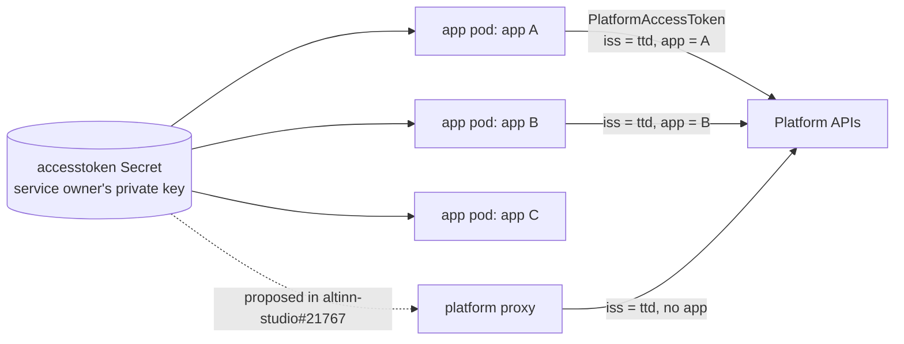

# 1. Background and goals

**TL;DR**

- Platform access tokens tell a platform API which service owner and app a request comes from, next to the user's token.
- For apps, every pod holds the service owner's signing key, so any compromised app can sign as every app.
- Kubernetes already gives each pod a short-lived, signed, audience-bound identity that can be verified offline.
- Goals: no key in the clusters, per-app identity where possible, revocation and audit in one place, vendor-neutral.
- altinn-authentication#824 asked for something similar without stating why. This page states the need.

> **Drafted with an AI assistant.** Claude Opus 5.5 (`claude-opus-5-5`) in Claude Code wrote this page from the code
> in this repository and the prototype branches, as research to propose a design. Reader: unspecified until a person
> confirms they have read it.

## Platform access tokens today

A **platform access token** is a JWT sent in the `PlatformAccessToken` request header. It tells a platform API which
issuer a request comes from: a service owner's apps, or the platform itself. For apps it can also name the app. It is
sent *next to* the user's token in `Authorization`. The user's token says who the request is for; the access token
says which software is making it.

Authentication is on both sides of these tokens:

| Side | Where in this repository |
| --- | --- |
| **Sends them** to other platform APIs, signed with its own key, through `IAccessTokenGenerator` | `AccessManagementClient`, `RegisterUserProvisioningClient`, `AltinnNotificationClient` (`src/apps/Altinn.Authentication/src/Altinn.Platform.Authentication.Integration/`) |
| **Accepts them**, validated by `AccessTokenHandler` from the shared `Altinn.Common.AccessToken` package | The `InternalOrPlatformAccess` policy: `InternalScopeOrAccessTokenRequirement` lets a request through with *either* an internal scope *or* a valid access token (`Core/Authorization/InternalScopeOrAccessTokenRequirement.cs`) |

Every issuer has one signing certificate. The private key is wherever tokens are signed. The validator looks up the
matching public certificate by the token's `iss`.

## What is wrong with that for apps

For an app, the "issuer" is its service owner, and the signing key is in the runtime cluster's `accesstoken`
Secret, which every app pod mounts:

**Diagram description:** One Kubernetes Secret holds the service owner's private signing key. Every app pod mounts
it: app A, app B and app C. A proposed platform proxy would read it too. Each holder signs its own platform access
tokens. App A's token says issuer `ttd`, app A. App B's says issuer `ttd`, app B. The proxy's says issuer `ttd` with
no app. The platform APIs receive all of them and can't tell whether a token's app claim is true, because any holder
of the key can write any app claim.

The consequences:

1. **Any compromised app is every app.** The key signs whatever claims its holder writes, so the app claim is only
   as trustworthy as the least secure app of that service owner.
2. **No revocation short of rotation.** A leaked key stays usable until the certificate is replaced and every holder
   reloads it. Nothing can switch off one app or one cluster.
3. **No central view.** Tokens are minted offline in thousands of pods. Nobody can see who got a token, when, or how
   many.
4. **The key spreads.** Each new component that calls the platform for apps is one more holder. The platform proxy
   in [altinn-studio#21767](https://github.com/Altinn/altinn-studio/pull/21767) (from
   [altinn-studio#21747](https://github.com/Altinn/altinn-studio/issues/21747)) is the latest example. Its review
   asked how to avoid this, which led to this design.

## What Kubernetes already provides

Every pod can get a **projected service account token**:
- signed by the cluster;
- with an audience the pod chooses;
- valid for as little as 10 minutes;
- bound to that pod;
- refreshed on disk by the kubelet.

Through **service account issuer discovery**, a cluster publishes its OIDC discovery document and JWKS, so anyone can
verify those tokens offline. This is the basis of cloud "workload identity federation", but the mechanism itself is
plain, vendor-neutral Kubernetes.

What such a token proves is "this is pod P of service account S in namespace N of cluster C". If each app has its own
service account (planned in [altinn-studio-charts#83](https://github.com/Altinn/altinn-studio-charts/issues/83)), that
identifies the app. If apps share a service account, as today, it still proves the cluster, and so the service owner.

## Goals

1. **No private key in the clusters for platform access.** A workload proves who it is with its service account
   token, and gets a short-lived app token from Authentication.
2. **Per-app identity where the cluster can provide it**, and service-owner identity where it can't. The token
   should never claim more than the cluster can vouch for.
3. **Revocation and audit in one place.** Disabling a cluster stops new tokens within minutes, and every token issued
   is counted and logged.
4. **Safe to introduce.** An app token must never be accepted where an Altinn token is expected, and nothing changes
   for current consumers until they choose to trust the new issuer.
5. **Vendor-neutral.** Built on Kubernetes and IETF standards, with no new dependency on a cloud identity provider.

## Non-goals

- Changing how users, organisations or system users authenticate.
- Changing how platform APIs authorize requests. This design delivers a verifiable identity; what an API does with it
  is the API's decision.
- Specifying changes in other repositories (the app library, the platform proxy, the runtime clusters, the platform
  APIs). [Rollout](08-rollout.md) and [open questions](10-open-questions.md) only describe the interface they need.
- Replacing Maskinporten or system users, which serve organisations outside Altinn. See [alternatives](09-alternatives.md).

## Prior issues

Both are in `Altinn/altinn-authentication`, archived since this vertical moved into this repository with its
history ([#4058](https://github.com/Altinn/altinn-auth/issues/4058)). Archived issues can't be reopened, so picking one up
means a new issue here.

| Issue | What it asked | How this design relates |
| --- | --- | --- |
| [altinn-authentication#824](https://github.com/Altinn/altinn-authentication/issues/824), "Lag API for genering av App token basert på access token" (closed June 2026, "no longer know what the need was") | An API, protected by an access token, that returns an Altinn token carrying the app from that access token, valid for an hour and signed with the standard Altinn certificate and issuer. | This design states the need, but changes three things. The input is a cluster-signed service account token, not an access token signed with the shared key, which would only launder the key. The token is signed with a **separate** key and issuer (see [05-app-token.md](05-app-token.md)). It lives 10 minutes, not an hour. |
| [altinn-authentication#1762](https://github.com/Altinn/altinn-authentication/issues/1762), "Autentiseringsproxy for apps cluster" (closed June 2026) | A proxy in the apps cluster, registered as an OIDC client, that signs users in and issues cookies for apps on other domains. | Different problem (browser sessions for users, not workload identity). It shows that a component in the apps cluster acting as a registered client of Authentication has been considered before. |
