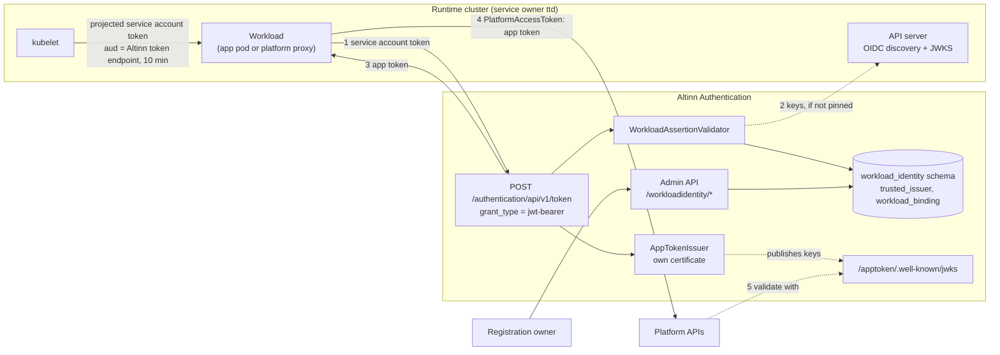
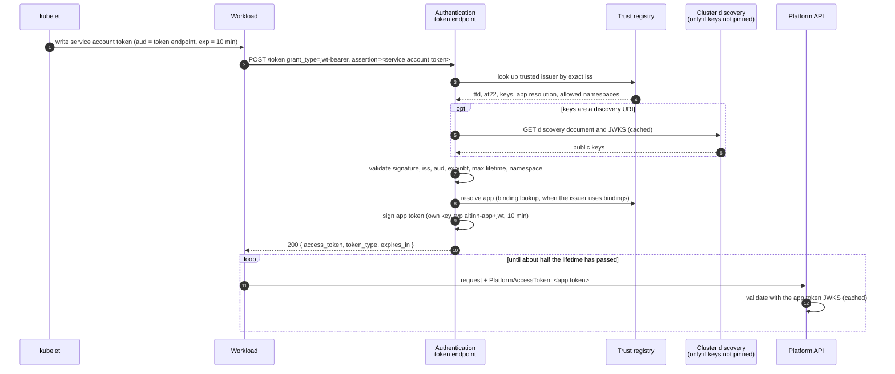
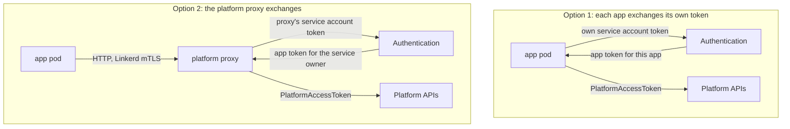

# 2. Solution overview

**TL;DR**

- Four parts: a trust registry, a `jwt-bearer` grant, an app token issuer with its own JWKS, and an admin API.
- A workload sends its service account token, gets a 10-minute app token, and sends it as `PlatformAccessToken`.
- Platform APIs validate app tokens offline with the app token JWKS.
- The exchange can happen in each app or in the platform proxy. The design supports both.

> **Drafted with an AI assistant.** Claude Opus 5.5 (`claude-opus-5-5`) in Claude Code wrote this page from the code
> in this repository and the prototype branches, as research to propose a design. Reader: unspecified until a person
> confirms they have read it.

## The parts

**Diagram description:**
- **In the runtime cluster:** the kubelet mounts a projected service account token into the workload, which is an
  app pod or the platform proxy. The token's audience is Altinn's token endpoint and it lives 10 minutes. The
  cluster's API server publishes its OIDC discovery document and public keys.
- **In Authentication:**
  - the token endpoint accepts the `jwt-bearer` grant;
  - a `WorkloadAssertionValidator` looks up the cluster in the `workload_identity` database schema;
  - an `AppTokenIssuer` signs with its own certificate, whose public key is published at
    `/apptoken/.well-known/jwks`;
  - an admin API writes the registry.
- **The flow:**
  1. The workload sends its service account token to the token endpoint.
  2. The validator fetches the cluster's keys from its discovery endpoint, unless they are pinned in the registry.
  3. Authentication returns an app token.
  4. The workload sends the app token to the platform APIs in the `PlatformAccessToken` header.
  5. The APIs validate it with the app token JWKS.

  Whoever owns registration manages the registry through the admin API.

| Part | Responsibility | Page |
| --- | --- | --- |
| Trust registry | Which clusters are trusted, for which service owner, with which keys, and how service accounts map to apps | [03](03-trust-registry.md) |
| Token exchange | The `jwt-bearer` grant: validate the service account token, resolve the app, issue the app token | [04](04-token-exchange.md) |
| App token issuer | Sign app tokens with a key, issuer, audience and claim set that are separate from Altinn tokens; publish the keys | [05](05-app-token.md) |
| Admin API | Register clusters and bindings, enable and disable them | [03](03-trust-registry.md#admin-api) |

## One exchange, end to end

**Diagram description:**
1. The kubelet writes a service account token for the workload, with Altinn's token endpoint as its audience and a
   10-minute expiry.
2. The workload posts it to Authentication's token endpoint as the assertion of a `jwt-bearer` grant.
3. Authentication looks up the trusted issuer by the token's exact `iss`.
4. The registry returns the service owner, environment, keys, app resolution and allowed namespaces.
5. Optionally, if the keys are registered as a discovery URI, Authentication fetches and caches the cluster's
   discovery document and JWKS.
6. Authentication validates the signature, issuer, audience, lifetime, maximum lifetime and namespace.
7. It resolves the app, looking up a binding if the issuer uses them.
8. It signs an app token with its own key, `typ` `altinn-app+jwt`, valid for 10 minutes.
9. It returns the token.
10. The workload sends requests to platform APIs with the app token in `PlatformAccessToken` until about half its
    lifetime has passed. Each API validates it with the app token JWKS, which it caches.

## Where the exchange happens

Two components could call the token endpoint. The design supports both and doesn't choose yet; see
[open question Q2](10-open-questions.md#q2-where-does-the-exchange-happen).

**Diagram description:**
- **Option 1:** each app pod sends its own service account token to Authentication, gets an app token for itself,
  and calls the platform APIs with it.
- **Option 2:** app pods call the platform proxy over HTTP with Linkerd mTLS. The proxy sends *its own* service
  account token to Authentication, gets an app token for the service owner, and adds it to the requests it forwards.

| | Option 1: in each app | Option 2: in the platform proxy |
| --- | --- | --- |
| Token names | The app, once apps have their own service accounts | The service owner only. The proxy's identity is not an app's. |
| Changes outside Authentication | App library: a token client instead of `AccessTokenGenerator`. Runtime: projected token volume per app. | Platform proxy: a token client instead of reading the `accesstoken` Secret. Runtime: one projected token volume. |
| Load on Authentication | One exchange per app pod per ~5 min | One per proxy pod per ~5 min |
| Per-app identity later | Comes for free with per-app service accounts | Needs a *delegation* extension: the proxy states the app from the caller's Linkerd identity, and Authentication trusts the proxy to do so. Not in this proposal. |

Both options use the same grant, the same validation and the same app token. Only the service account behind the
assertion, and its [app resolution](03-trust-registry.md#app-resolution), differ.
