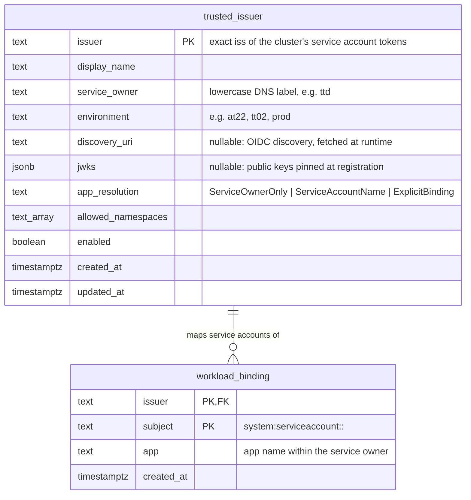
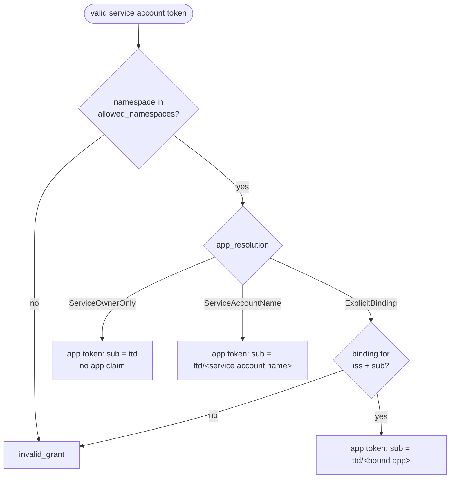
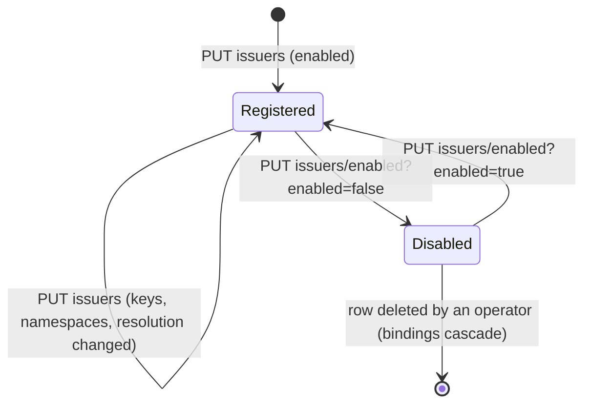

# 3. Trust registry

**TL;DR**

- One row per cluster, keyed by the exact `iss` of its service account tokens.
- Three app resolution modes: service owner only, service account name, or an explicit binding.
- A cluster's keys come from its discovery endpoint, or are pinned at registration.
- A scoped admin API registers, changes and disables clusters and bindings. Who calls it is still open.

> **Drafted with an AI assistant.** Claude Opus 5.5 (`claude-opus-5-5`) in Claude Code wrote this page from the code
> in this repository and the prototype branches, as research to propose a design. Reader: unspecified until a person
> confirms they have read it.

Authentication must know which clusters it trusts, and what each may claim. That knowledge is data, not
configuration: clusters come and go with environments and service owners, and disabling one must not need a deploy.

## Data model



**Diagram description:** There are two tables in a new `workload_identity` schema.
- **`trusted_issuer`** has one row per cluster, keyed by the exact `iss` of the cluster's service account tokens.
  It holds:
  - a display name, the service owner and the environment;
  - the cluster's public keys, either as a discovery URI or as a pinned JWKS, with at least one required;
  - the app resolution mode;
  - the namespaces whose service accounts may get tokens;
  - an enabled flag and timestamps.
- **`workload_binding`** maps one service account subject in one cluster to one app name. Its key is the pair of
  issuer and subject, and it is deleted with its issuer.

Database constraints enforce that every issuer has keys, that the app resolution is one of the three modes, and
that the service owner is a lowercase DNS label.

Code: [migration v0.30](https://github.com/ivarne-agent/altinn-auth/tree/ab4b3d845e6749fb8c9843d6eb21d5cd39ed5a17/src/apps/Altinn.Authentication/src/Altinn.Platform.Authentication.Persistance/Migration/v0.30),
[TrustedWorkloadIssuer](https://github.com/ivarne-agent/altinn-auth/blob/ab4b3d845e6749fb8c9843d6eb21d5cd39ed5a17/src/apps/Altinn.Authentication/src/Altinn.Platform.Authentication.Core/Models/WorkloadIdentity/TrustedWorkloadIssuer.cs),
[repository](https://github.com/ivarne-agent/altinn-auth/blob/ab4b3d845e6749fb8c9843d6eb21d5cd39ed5a17/src/apps/Altinn.Authentication/src/Altinn.Platform.Authentication.Persistance/RepositoryImplementations/WorkloadIdentity/TrustedWorkloadIssuerRepository.cs).

### Why the issuer is the key

The `iss` of a Kubernetes service account token is configured per cluster (`--service-account-issuer`), and it's what
discovery is keyed on. Using it **exactly** as the key means:
- a token is matched to its cluster before its signature is checked;
- that cluster's keys are the only ones tried;
- a key from cluster A can never validate a token claiming to be from cluster B.

No trailing-slash leniency is applied, unlike the historical upstream-token path ([altinn-authentication#2074](https://github.com/Altinn/altinn-authentication/issues/2074)).

## App resolution

The cluster decides how much a service account token can tell about the app. The registry records which of three
rules applies:

| Mode | The app token names | When to use | Trust assumption |
| --- | --- | --- | --- |
| `ServiceOwnerOnly` | The service owner, no app | Apps share a service account, as they do today, or the caller is the platform proxy | The cluster runs only that service owner's workloads in the allowed namespaces |
| `ServiceAccountName` | `{serviceowner}/{service account name}` | Each app has its own service account, named after the app ([altinn-studio-charts#83](https://github.com/Altinn/altinn-studio-charts/issues/83)) | Only the app's deployment may use that service account name in an allowed namespace |
| `ExplicitBinding` | The app in the `workload_binding` row for the service account; no row means no token | Service account names don't match app names, or per-app registration is wanted | Whoever writes bindings is trusted for that cluster |

All three modes require the service account's namespace to be in `allowed_namespaces`. A service account in
`kube-system`, or in any namespace that isn't listed, never gets an app token.



**Diagram description:** Starting from a service account token that has passed validation, the first check is
whether its namespace is in the issuer's allowed namespaces. If not, the request is rejected with `invalid_grant`.
If it is, the issuer's app resolution decides:
- **ServiceOwnerOnly:** an app token whose subject is the service owner, with no app claim.
- **ServiceAccountName:** an app token whose subject is the service owner and the service account's name.
- **ExplicitBinding:** the registry is checked for a binding of this issuer and subject. With no binding the request
  is rejected with `invalid_grant`. With one, the app token's subject is the service owner and the bound app.

Code: [`AppTokenService.ExchangeAsync`](https://github.com/ivarne-agent/altinn-auth/blob/1a41df8b93e57a9bb935e29c6506058d4b5b9210/src/apps/Altinn.Authentication/src/Altinn.Platform.Authentication/Services/AppTokenService.cs#L56-L77).

## Where the keys come from

| | `discovery_uri` | `jwks` (pinned) |
| --- | --- | --- |
| How | Authentication fetches `{discovery_uri}`, then its `jwks_uri`, and caches both through the same OIDC configuration manager it uses for ID-porten and Maskinporten | The registration holds the public keys, read from the cluster's `/openid/v1/jwks` when it is registered |
| Cluster key rotation | Followed automatically when the cache refreshes | The registration must be updated **before** the cluster signs with a new key |
| Runtime dependency | The discovery endpoint must be reachable from Authentication. On AKS it is hosted by Azure at a public URL. Self-managed clusters must publish it somewhere reachable. | None. Validation is offline. |
| A compromised discovery host can | Serve its own keys, and so mint tokens for that cluster. HTTPS and the exact issuer limit this to that one cluster. | Nothing. It isn't consulted. |

Both are supported. A registration has exactly one, enforced by the API, and at least one, enforced by the database.
Pinning removes a runtime dependency on a host Altinn doesn't control, which matters given the wish to avoid
depending more on Azure than necessary. It costs a registration update per key rotation. See
[open question Q5](10-open-questions.md#q5-discovery-or-pinned-keys-by-default).

A pinned JWKS with a private key part (`d`, `p`, `q`, `dp`, `dq`, `qi`, `k`) is refused. Storing one would mean a
cluster's signing key had leaked into Altinn's database.

## Admin API

All endpoints are under `/authentication/api/v1/workloadidentity`. They require the scope
`altinn:authentication/workloadidentity.admin`, and the `AppTokens` feature flag hides them entirely.

| Method and path | Purpose |
| --- | --- |
| `GET issuers` | List registered clusters |
| `GET issuers/lookup?issuer=` | One cluster. The issuer is a URL, so it goes in the query, not the path. |
| `PUT issuers` | Register a cluster, or replace its registration (body below) |
| `PUT issuers/enabled?issuer=&enabled=` | Switch a cluster off or on. New tokens stop at once; tokens already issued expire within their lifetime. |
| `PUT bindings` | Bind a service account to an app, for a cluster that uses `ExplicitBinding` |
| `DELETE bindings?issuer=&subject=` | Remove a binding |

```json
PUT /authentication/api/v1/workloadidentity/issuers
{
  "issuer": "https://westeurope.oic.prod-aks.azure.com/<tenant>/<cluster>/",
  "displayName": "ttd at22 runtime",
  "serviceOwner": "ttd",
  "environment": "at22",
  "discoveryUri": "https://westeurope.oic.prod-aks.azure.com/<tenant>/<cluster>/.well-known/openid-configuration",
  "appResolution": "ServiceOwnerOnly",
  "allowedNamespaces": ["default", "runtime-platform-proxy"],
  "enabled": true
}
```

Validation:
- the issuer and discovery URI must be absolute `https` URIs without query, fragment or user info;
- the service owner and environment must be lowercase DNS labels;
- exactly one of `discoveryUri` or `jwks` must be given;
- a JWKS must parse, have at least one key and contain no private parts;
- at least one namespace is required, and each must be a valid name;
- a binding's subject must be `system:serviceaccount:<ns>:<name>` with an allowed namespace, and its issuer must use
  `ExplicitBinding`.

Code: [controller](https://github.com/ivarne-agent/altinn-auth/blob/ab4b3d845e6749fb8c9843d6eb21d5cd39ed5a17/src/apps/Altinn.Authentication/src/Altinn.Platform.Authentication/Controllers/WorkloadIdentityAdminController.cs),
[validation](https://github.com/ivarne-agent/altinn-auth/blob/ab4b3d845e6749fb8c9843d6eb21d5cd39ed5a17/src/apps/Altinn.Authentication/src/Altinn.Platform.Authentication/Helpers/WorkloadIdentityValidation.cs).

## Who registers clusters

This is undecided ([Q1](10-open-questions.md#q1-who-owns-registrations)). The API doesn't depend on the answer.
Whichever client holds the admin scope can register. The candidates:

| Owner | How | Fit |
| --- | --- | --- |
| Altinn operations, by hand | A script or `.http` file per new cluster | Few clusters, rare changes, so this may be enough at first |
| The runtime cluster provisioning pipeline | Registers the cluster's issuer when it creates the cluster, and disables it when it tears it down | Keeps the registry in step with reality. The pipeline needs the admin scope. |
| Altinn Studio, per app | Writes bindings on deploy, for `ExplicitBinding` | Only needed if service account names don't identify apps |

## Lifecycle



**Diagram description:** A cluster becomes registered and enabled when it is first put. While registered, its
registration can be replaced, for example to change its keys, namespaces or app resolution. It can be disabled,
which stops new tokens, and enabled again. A disabled cluster can be removed by deleting its row, which also deletes
its bindings. The prototype has no API for deleting, on purpose: a disabled row keeps the history of what was once
trusted.
