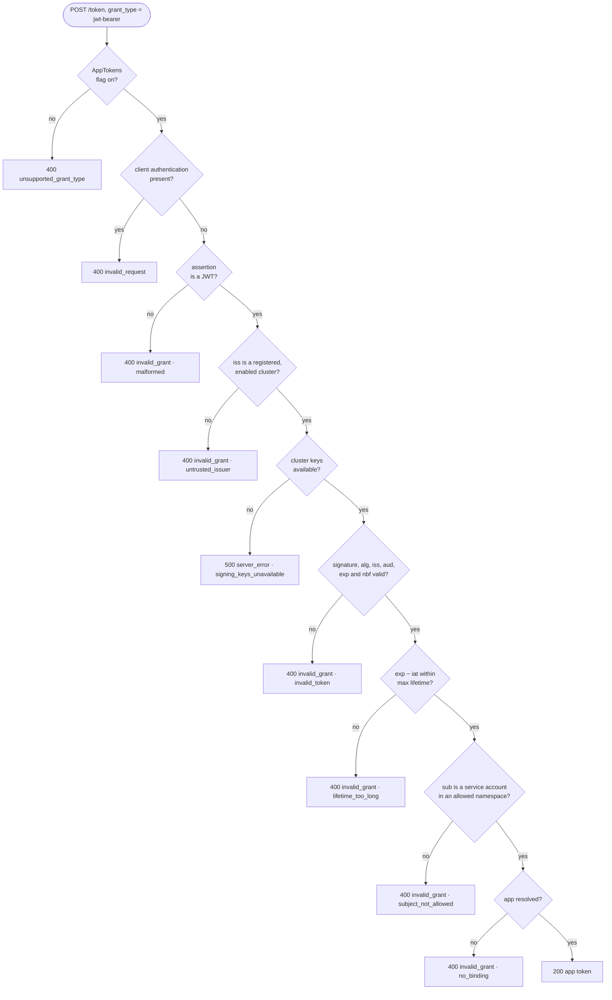

# 4. Token exchange

**TL;DR**

- `POST /token` with `grant_type=urn:ietf:params:oauth:grant-type:jwt-bearer` and the service account token as `assertion`.
- Validated offline and strictly: exact issuer and audience, RS256 or ES256, lifetime, maximum lifetime, allowed namespace.
- Every rejection is `invalid_grant` with the same description. The reason goes to metrics and logs.
- No client authentication. Offline validation can't see deleted pods, so lifetimes are kept short.

> **Drafted with an AI assistant.** Claude Opus 5.5 (`claude-opus-5-5`) in Claude Code wrote this page from the code
> in this repository and the prototype branches, as research to propose a design. Reader: unspecified until a person
> confirms they have read it.

## Protocol choice

The exchange is the **JWT bearer authorization grant** of [RFC 7523 §2.1](https://www.rfc-editor.org/rfc/rfc7523#section-2.1)
on the existing token endpoint, `POST /authentication/api/v1/token`. The service account token *is* the
authorization grant, and the workload needs no other credential.

- **Why the existing endpoint:** `OidcTokenController` already dispatches on `grant_type`, so the new grant is one
  more `case`. Discovery, HTTP caching rules and error formats are shared.
- **Why RFC 7523, not RFC 8693 token exchange:** RFC 7523 is the smaller standard and fits "a signed assertion in,
  an access token out". [RFC 8693](https://www.rfc-editor.org/rfc/rfc8693) would fit better if the
  [delegation extension](02-solution-overview.md#where-the-exchange-happens) is ever needed, where the platform proxy
  acts for an app (`actor_token`). See [Q4](10-open-questions.md#q4-rfc-7523-or-rfc-8693). The validation below
  applies to both.
- **Why no client authentication:** the assertion is signed by the cluster for this audience and lives for minutes.
  A client secret would be a long-lived shared secret in the cluster, the thing this design removes. A request that
  also carries client authentication is rejected with `invalid_request`, so nobody mistakes it for an extra check.

## Getting the service account token

The workload asks Kubernetes for a projected token with Authentication's token endpoint as the audience. Nothing
else in Kubernetes accepts a token with that audience, and nothing else should hold one.

```yaml
# Pod spec (illustrative). The app library or platform proxy reads the file before each exchange.
volumes:
  - name: altinn-token
    projected:
      sources:
        - serviceAccountToken:
            audience: https://platform.tt02.altinn.no/authentication/api/v1/token
            expirationSeconds: 600   # Kubernetes' minimum. The kubelet refreshes it at 80 % of its lifetime.
            path: token
containers:
  - name: app
    volumeMounts:
      - name: altinn-token
        mountPath: /var/run/secrets/altinn
        readOnly: true
```

A token from that volume, decoded:

```json
{
  "alg": "RS256",
  "kid": "x8gKb..."
}
{
  "iss": "https://westeurope.oic.prod-aks.azure.com/<tenant>/<cluster>/",
  "sub": "system:serviceaccount:default:my-app",
  "aud": ["https://platform.tt02.altinn.no/authentication/api/v1/token"],
  "iat": 1794222000,
  "nbf": 1794222000,
  "exp": 1794222600,
  "jti": "5e0b...",
  "kubernetes.io": {
    "namespace": "default",
    "serviceaccount": { "name": "my-app", "uid": "..." },
    "pod": { "name": "my-app-7d9f8-abc12", "uid": "..." }
  }
}
```

## Request and response

```http
POST /authentication/api/v1/token HTTP/1.1
Host: platform.tt02.altinn.no
Content-Type: application/x-www-form-urlencoded

grant_type=urn%3Aietf%3Aparams%3Aoauth%3Agrant-type%3Ajwt-bearer
&assertion=eyJhbGciOiJSUzI1NiIsImtpZCI6Ing4Z0tiLi4uIn0.eyJpc3MiOi...
```

```http
HTTP/1.1 200 OK
Content-Type: application/json
Cache-Control: no-store

{
  "access_token": "eyJhbGciOiJSUzI1NiIsImtpZCI6IjFBMkIzQy4uLiIsInR5cCI6ImFsdGlubi1hcHArand0In0...",
  "token_type": "Bearer",
  "expires_in": 600
}
```

`token_type` is `Bearer` because RFC 6749 requires one. The token is used as a `PlatformAccessToken`, not in
`Authorization`; see [05-app-token.md](05-app-token.md#how-it-is-sent).

## Validation, step by step



**Diagram description:** A token request with the `jwt-bearer` grant goes through these checks in order. The first
one that fails decides the response.
1. If the `AppTokens` feature flag is off: `400 unsupported_grant_type`, as if the grant didn't exist.
2. If the request carries client authentication: `400 invalid_request`.
3. If the assertion is not a JWT: `400 invalid_grant` (malformed).
4. If its issuer isn't a registered, enabled cluster: `400 invalid_grant` (untrusted issuer).
5. If the cluster's keys can't be read: `500 server_error` (signing keys unavailable). This is the only failure that
   isn't the caller's fault.
6. If the signature, algorithm, issuer, audience, expiry or not-before is invalid: `400 invalid_grant` (invalid
   token).
7. If the token is valid for longer than the maximum assertion lifetime: `400 invalid_grant` (lifetime too long).
8. If the subject isn't a service account in an allowed namespace: `400 invalid_grant` (subject not allowed).
9. If the app can't be resolved, meaning no binding exists for a cluster that uses bindings: `400 invalid_grant` (no
   binding).

Otherwise the response is `200` with an app token. The value after each `invalid_grant` is the low-cardinality
`error.type` recorded in metrics. It never appears in the response.

| Step | Check | Why |
| --- | --- | --- |
| Issuer lookup | The *unvalidated* `iss` is used only to find the registration and its keys | Each cluster's keys validate only that cluster's tokens |
| Algorithm | `RS256` or `ES256` only | Kubernetes signs with these. Never `none`, never HMAC, so a public key can't be misused as an HMAC secret ([RFC 8725 §3.1](https://www.rfc-editor.org/rfc/rfc8725#section-3.1)). |
| Issuer | Exact match with the registration, no trailing-slash leniency | Unlike [the historical exchange path](../../flows/token-exchange.md#verification--known-issues) |
| Audience | Exact match with `AppTokenSettings:AssertionAudience`. `IgnoreTrailingSlashWhenValidatingAudience` is off. | A token for the cluster's own API server, or for anything else, is useless here |
| Lifetime | `exp` required; `nbf` honoured; 10 s clock skew; time from `TimeProvider` | Testable with a fake clock |
| Maximum lifetime | `exp − iat` ≤ `MaxAssertionLifetimeMinutes` (default 60), and `iat` required | A long-lived token, such as a legacy Secret-based one, is a credential that leaks for longer |
| Subject | `system:serviceaccount:<ns>:<name>` with both parts DNS labels, and `<ns>` in `allowed_namespaces` | Nodes, users and other namespaces never get app tokens |
| Errors | One `error_description` for every `invalid_grant` | The endpoint doesn't reveal which clusters are trusted or why a token failed. The reason goes to logs and metrics. |

Code: [`WorkloadAssertionValidator.ValidateAsync`](https://github.com/ivarne-agent/altinn-auth/blob/1a41df8b93e57a9bb935e29c6506058d4b5b9210/src/apps/Altinn.Authentication/src/Altinn.Platform.Authentication/Services/WorkloadAssertionValidator.cs#L64-L142),
[the new `case` in `OidcTokenController`](https://github.com/ivarne-agent/altinn-auth/blob/1a41df8b93e57a9bb935e29c6506058d4b5b9210/src/apps/Altinn.Authentication/src/Altinn.Platform.Authentication/Controllers/OidcTokenController.cs#L96-L106),
[tests for every row above](https://github.com/ivarne-agent/altinn-auth/blob/1a41df8b93e57a9bb935e29c6506058d4b5b9210/src/apps/Altinn.Authentication/test/Altinn.Platform.Authentication.Tests/Controllers/AppTokenExchangeTests.cs).

## What offline validation can't see

The validator never calls the cluster's API server. That keeps Authentication free of credentials for, and network
paths to, every runtime cluster. The price is that it can't use Kubernetes' **TokenReview**, which is the only check
that sees whether the pod a token is bound to still exists. A token taken from a pod that has since been deleted
stays valid until it expires.

Two things bound that window:
- the maximum assertion lifetime: Kubernetes allows projected tokens as short as 10 minutes, and the design
  recommends exactly that;
- the audience: the stolen token is good only for this exchange.

[06-security.md](06-security.md) weighs this. [Alternative G](09-alternatives.md#g-online-validation-with-tokenreview)
describes the online variant.

## Replay

A service account token can be exchanged more than once while it is valid. The design allows this on purpose: the
kubelet refreshes the file only at 80 % of its lifetime, so a workload that restarts, or runs several replicas of a
client, presents the same token again. Rejecting a repeated `jti` would break that and protect little, since an
attacker holding the token can use it before the workload does. Replay is bounded by the token's lifetime and
audience, as above.
