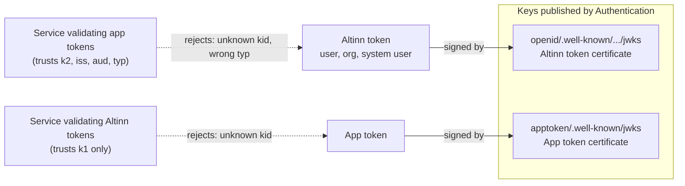

# 5. The app token

**TL;DR**

- A JWT with `typ` `altinn-app+jwt`, `sub` `{serviceowner}/{app}` and `urn:altinn:apptoken:*` claims, valid 10 minutes.
- Signed with its own certificate and issuer, and published in its own JWKS, so it is never accepted as an Altinn token.
- Sent as the value of the existing `PlatformAccessToken` header.
- A consumer validates issuer, audience, type and lifetime against the app token metadata.

> **Drafted with an AI assistant.** Claude Opus 5.5 (`claude-opus-5-5`) in Claude Code wrote this page from the code
> in this repository and the prototype branches, as research to propose a design. Reader: unspecified until a person
> confirms they have read it.

## What it looks like

```json
{
  "alg": "RS256",
  "kid": "1A2B3C4D5E6F...",
  "typ": "altinn-app+jwt"
}
{
  "iss": "https://platform.tt02.altinn.no/authentication/api/v1/apptoken",
  "aud": "https://platform.tt02.altinn.no/",
  "sub": "ttd/my-app",
  "jti": "9f2c6b0e8d4a4f3b9c1e7a5d2b8f0c3e",
  "iat": 1794222010,
  "nbf": 1794222010,
  "exp": 1794222610,
  "urn:altinn:apptoken:serviceowner": "ttd",
  "urn:altinn:apptoken:app": "ttd/my-app",
  "urn:altinn:apptoken:workload_iss": "https://westeurope.oic.prod-aks.azure.com/<tenant>/<cluster>/",
  "urn:altinn:apptoken:workload_sub": "system:serviceaccount:default:my-app"
}
```

| Claim | Value | Notes |
| --- | --- | --- |
| `typ` (header) | `altinn-app+jwt` | Explicit typing ([RFC 8725 §3.11](https://www.rfc-editor.org/rfc/rfc8725#section-3.11)). A consumer can require it, and a consumer of other tokens can refuse it. |
| `kid` (header) | Thumbprint of the app token certificate | As for Altinn tokens |
| `iss` | `AppTokenSettings:Issuer` | Must differ from the Altinn token issuer (`GeneralSettings:AltinnOidcIssuerUrl`) |
| `aud` | `AppTokenSettings:Audience` | The platform APIs. One audience for all, or one per API: [Q7](10-open-questions.md#q7-one-audience-or-one-per-api). |
| `sub` | `{serviceowner}/{app}`, or `{serviceowner}` | What the token is about, in one string |
| `urn:altinn:apptoken:serviceowner` | `ttd` | Always present |
| `urn:altinn:apptoken:app` | `ttd/my-app` | Only when the cluster's [app resolution](03-trust-registry.md#app-resolution) names an app |
| `urn:altinn:apptoken:workload_iss` / `workload_sub` | The cluster and the service account | For audit and for a consumer that wants to be stricter. Not secret, and not personal data. |
| `jti`, `iat`, `nbf`, `exp` | | Lifetime is `AppTokenSettings:LifetimeMinutes`, default 10 |

Code: [`AppTokenIssuer`](https://github.com/ivarne-agent/altinn-auth/blob/fd182d1deea6960032989d70ba64a86bb58c14e0/src/apps/Altinn.Authentication/src/Altinn.Platform.Authentication/Services/AppTokenIssuer.cs),
[`AppTokenClaimTypes`](https://github.com/ivarne-agent/altinn-auth/blob/fd182d1deea6960032989d70ba64a86bb58c14e0/src/apps/Altinn.Authentication/src/Altinn.Platform.Authentication.Core/Constants/AppTokenClaimTypes.cs).

## Why it has its own key, issuer and claims

Authentication signs every token it issues today with one certificate and one issuer
(`TokenIssuerService.GenerateToken`). Other services validate Altinn tokens with the JWKS published at
`/authentication/api/v1/openid/.well-known/openid-configuration/jwks`. Authentication can't assume that every one of
them checks `iss`, `aud` and `typ`. Many treat "signed with the Altinn key" as "is an Altinn token", and act on claims
such as `urn:altinn:org`.

If app tokens were signed with that key, as [altinn-authentication#824](https://github.com/Altinn/altinn-authentication/issues/824) once
proposed, an app token naming `ttd` could be sent as `Authorization: Bearer`. Some services would then read it as a
token for the organisation `ttd`. The design rules this out in three independent ways:



**Diagram description:** Authentication publishes two separate key sets. The Altinn token certificate, at
`openid/.well-known/openid-configuration/jwks`, signs Altinn tokens for users, organisations and system users. The
app token certificate, at `apptoken/.well-known/jwks`, signs app tokens only.
- A service that validates Altinn tokens trusts only the first key set. It rejects an app token because the app
  token's key ID isn't in that set.
- A service that validates app tokens trusts the second key set and also checks issuer, audience and type. It
  rejects an Altinn token because of an unknown key ID and the wrong type.

1. **A separate certificate.** It is a different Key Vault certificate (`AppTokenSettings:CertificateName`), whose
   public key is published only at `/authentication/api/v1/apptoken/.well-known/jwks`. A service that has only the
   Altinn token JWKS can't validate an app token at all. The [prototype test](https://github.com/ivarne-agent/altinn-auth/blob/fd182d1deea6960032989d70ba64a86bb58c14e0/src/apps/Altinn.Authentication/test/Altinn.Platform.Authentication.Tests/Services/AppTokenIssuerTests.cs)
   asserts that the key sets don't overlap and that an app token fails against the Altinn certificate.
2. **A separate issuer, audience and `typ`.** A consumer that checks any of them rejects the other kind of token.
3. **Claims in their own namespace (`urn:altinn:apptoken:*`).** Even a misconfigured consumer that accepted the
   signature would find none of the claims it authorizes on (`urn:altinn:org`, `urn:altinn:userid`, `scope`, …).

The third measure costs compatibility. Consumers of today's platform access tokens read the issuer as the service
owner, and an app claim. Whether app tokens should mimic those, or consumers should adapt, is
[Q3](10-open-questions.md#q3-claim-compatibility-with-todays-consumers).

## Keys and metadata

| Endpoint | Content |
| --- | --- |
| `GET /authentication/api/v1/apptoken/.well-known/oauth-authorization-server` | [RFC 8414](https://www.rfc-editor.org/rfc/rfc8414) metadata: `issuer`, `token_endpoint`, `jwks_uri`, `grant_types_supported` = `jwt-bearer`, `token_endpoint_auth_methods_supported` = `none` |
| `GET /authentication/api/v1/apptoken/.well-known/jwks` | The app token certificate's versions, newest first, each with its chain and the thumbprint as `kid` |

The `AppTokens` flag gates both endpoints. A new certificate version is published for
`AppTokenSettings:RolloverDelayHours` (default 48) before it signs, using the same rule as Altinn tokens, which the
prototype moved into a shared `SigningCertificateSelector`.

Code: [`AppTokenWellKnownController`](https://github.com/ivarne-agent/altinn-auth/blob/fd182d1deea6960032989d70ba64a86bb58c14e0/src/apps/Altinn.Authentication/src/Altinn.Platform.Authentication/Controllers/AppTokenWellKnownController.cs).

## How it is sent

The app token replaces the *value* of the `PlatformAccessToken` header. The header stays the same, so the user's
token stays in `Authorization` as it does today:

```http
POST /storage/api/v1/instances/... HTTP/1.1
Authorization: Bearer <the user's Altinn token>
PlatformAccessToken: <app token>
```

## How a consumer validates it

A consumer that decides to trust app tokens adds a second validation for the `PlatformAccessToken` header, next to
today's per-issuer certificates:

| Setting | Value |
| --- | --- |
| Keys | From `jwks_uri` in the app token metadata, cached and refreshed on an unknown `kid` |
| Issuer | Exactly `AppTokenSettings:Issuer` of that environment |
| Audience | Exactly the consumer's audience |
| Type | `altinn-app+jwt` required |
| Lifetime | Validated, with a small clock skew |
| Identity | `urn:altinn:apptoken:serviceowner`, and `urn:altinn:apptoken:app` when present |

How each platform API does this is outside this repository and this ADR. Rolling it out is phase 3 of
[08-rollout.md](08-rollout.md).

## Lifetime and caching

App tokens live **10 minutes** by default. A workload should:
- reuse its app token until about half its lifetime has passed, then get a new one;
- keep using the old token while the new request is in flight;
- read the service account token file afresh for each exchange, because the kubelet replaces it.

With that pattern, Authentication sees one exchange per workload pod about every 5 minutes. Platform APIs never see
a token with less than about 5 minutes left. A short outage of Authentication (under about 5 minutes) is invisible
to the platform APIs. [07-operations.md](07-operations.md#availability) covers longer ones.
