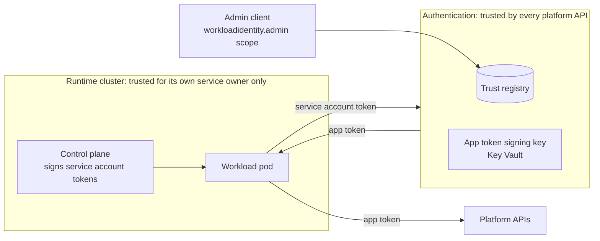
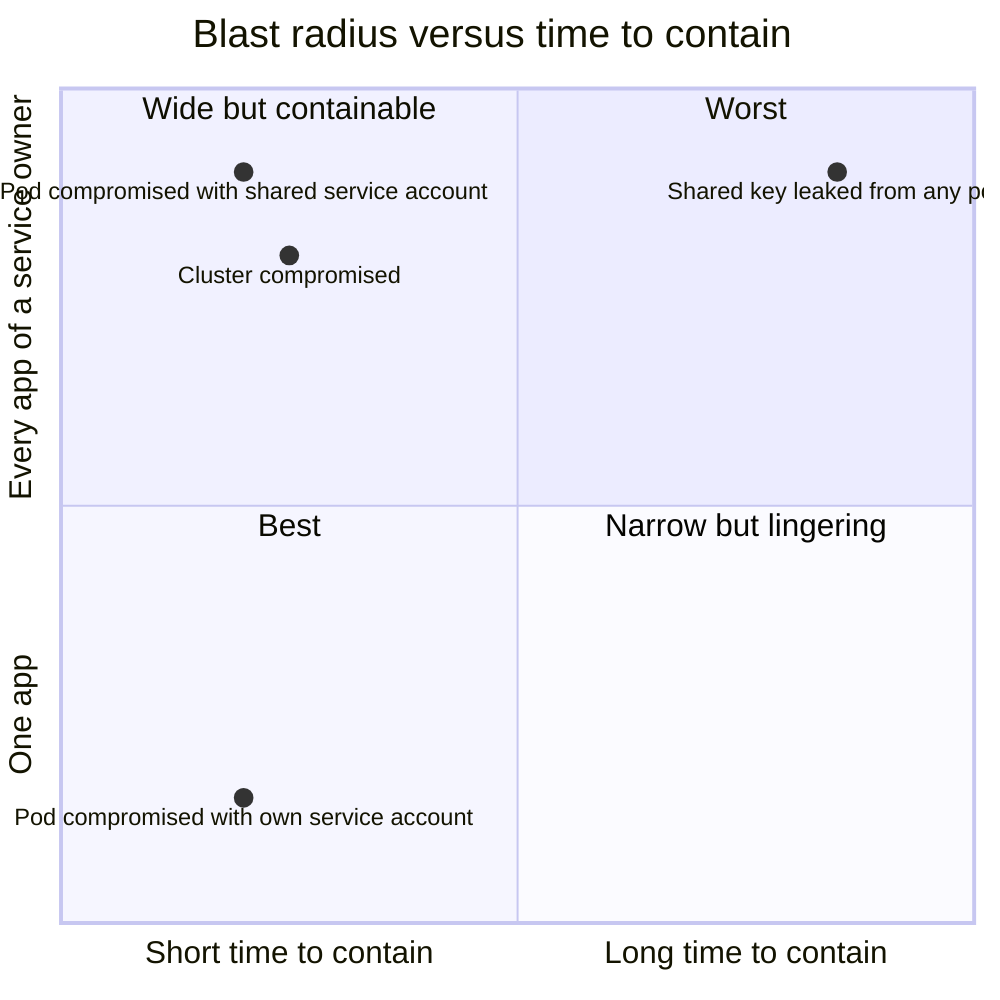

# 6. Security

**TL;DR**

- A compromised pod gets tokens for its own service account only, never the service owner's key.
- A compromised cluster has today's blast radius, but one switch contains it within minutes.
- The trust registry is the new critical asset. Audit, alerting and a narrow admin scope are required before production.
- A separate key, issuer, `typ` and claim namespace prevent token confusion.
- Authentication becomes an availability dependency of apps' platform calls.

> **Drafted with an AI assistant.** Claude Opus 5.5 (`claude-opus-5-5`) in Claude Code wrote this page from the code
> in this repository and the prototype branches, as research to propose a design. Reader: unspecified until a person
> confirms they have read it.

## What is protected, and by whom it is trusted

**Diagram description:** There are three trust boundaries.
- **The runtime cluster** is trusted only for its own service owner. Its control plane signs service account tokens
  for its workload pods.
- **Authentication** is trusted by every platform API. It holds the trust registry and the app token signing key,
  which is kept in Key Vault.
- **An admin client** with the `workloadidentity.admin` scope writes the trust registry.

The workload pod sends a service account token to Authentication, gets an app token back, and presents it to the
platform APIs.

| Asset | Why it matters | Protection |
| --- | --- | --- |
| App token signing key | Signs app tokens for every service owner | Key Vault, the same handling as the Altinn token key. Never leaves Authentication. |
| Trust registry | Decides which cluster may claim which service owner, and with which keys | Admin scope, feature flag, validation of every write, database constraints |
| Service account tokens in transit | Each one is good for one exchange for a few minutes | Audience bound to the token endpoint, 10-minute lifetime, TLS |
| App tokens | Each one is good for platform calls for 10 minutes | Short lifetime, own audience, `typ` and key |

## Threats

| # | Threat | Today, with the shared key | With app tokens | Residual risk |
| --- | --- | --- | --- | --- |
| T1 | **An app pod is compromised** | The attacker has the private key and can sign as **any app** of the service owner, for as long as the certificate lives | The attacker gets tokens for **that pod's service account**: one app, or the service owner when apps share a service account. They can't make tokens without the pod's live token. | Equal to today while apps share a service account (`ServiceOwnerOnly`). Strictly better once apps have their own. |
| T2 | **A service account token is stolen**, from logs or a debug dump | n/a | Usable only for this exchange, until it expires (at most `MaxAssertionLifetimeMinutes`; 10 min recommended). Offline validation can't see that the pod was deleted. | Bounded by lifetime and audience. See [04](04-token-exchange.md#what-offline-validation-cant-see). |
| T3 | **An app token is stolen** | A stolen access token is likewise a bearer token, but anyone holding the key mints more | Usable until it expires (10 min) at APIs that accept its audience | Bearer token risk, short-lived. Sender-constraining (DPoP, mTLS) is a possible later hardening. |
| T4 | **A cluster's control plane is compromised** | The attacker reads the `accesstoken` Secret: every app of the service owner, until rotation | The attacker mints service account tokens for any service account: every app of **that cluster's** service owner | Same blast radius as today, but **one switch** (disable the issuer) ends it within the app token lifetime, with no certificate rotation |
| T5 | **The trust registry is written by an attacker** | n/a | Registering their own "cluster" for any service owner lets them mint tokens as that service owner | New, and the most important risk. Mitigations: a narrow admin scope held by few clients, validation, audit (to add, see below), alerting on new registrations. |
| T6 | **A cluster's discovery host is compromised or spoofed** | n/a | With `discovery_uri`, the attacker serves keys that validate their own tokens for **that cluster** | HTTPS and the exact issuer limit it to one cluster. [Pinned keys](03-trust-registry.md#where-the-keys-come-from) remove it. |
| T7 | **Token confusion:** an app token used where an Altinn token is expected, or the reverse | n/a | Prevented by a separate key, issuer, audience, `typ` and claim namespace, each on its own | See [05](05-app-token.md#why-it-has-its-own-key-issuer-and-claims) |
| T8 | **Algorithm confusion** (`none`, HMAC with a public key) | Depends on the consumer | The validator allows only `RS256`/`ES256` and only keys from the registration | None known |
| T9 | **Enumeration:** probing which clusters are trusted | n/a | One `invalid_grant` description for every rejection | Timing differences (database lookup versus not) remain, and are low value |
| T10 | **Denial of service** on the token endpoint | n/a | Every exchange costs a database lookup and an RSA signature | Rate limiting per issuer is not in the prototype. See [07](07-operations.md#load). |
| T11 | **Authentication is unavailable** | Apps sign offline and keep working | New app tokens can't be issued, and platform calls fail once cached tokens expire | An availability dependency, not a confidentiality one. See [07](07-operations.md#availability). |

## What it improves on today

**Diagram description:** The chart places each scenario by how many apps an attacker can act as (vertical axis,
from one app at the bottom to every app of a service owner at the top) and how long it takes to contain (horizontal
axis, short on the left, long on the right).
- **A key leaked from any pod today** is in the worst corner: top right, every app and long to contain, because the
  certificate must be rotated everywhere.
- **With app tokens, a compromised pod whose apps share a service account** is top left: every app of the service
  owner, but contained within minutes by disabling the cluster.
- **A compromised pod with its own service account** is bottom left: one app, contained within minutes.
- **A compromised cluster with app tokens** is near the top left: nearly every app, contained within minutes.

## Required hardening before production

These aren't in the prototype, and should be in place before the flag is turned on outside test environments:

1. **An audit trail for registry writes:** who registered, changed, enabled or disabled which cluster, through the
   existing `EventLogService` or a history table.
2. **Alerting** on new or changed registrations, and on a high rejection rate per `error.type`.
3. **Rate limiting** of the `jwt-bearer` grant, per trusted issuer.
4. **A threat-model review** by the security function, per the repository's PR template ("Trusselmodellering").
5. **A decision on `allowed_namespaces`** per cluster that excludes everything but app and proxy namespaces.

## Privacy

Neither the service account token nor the app token contains personal data. Subjects are service account names,
apps are app names, and issuers are cluster URLs. Logs record the issuer, subject and app of each issued token,
which is the audit trail, and never the tokens themselves.
