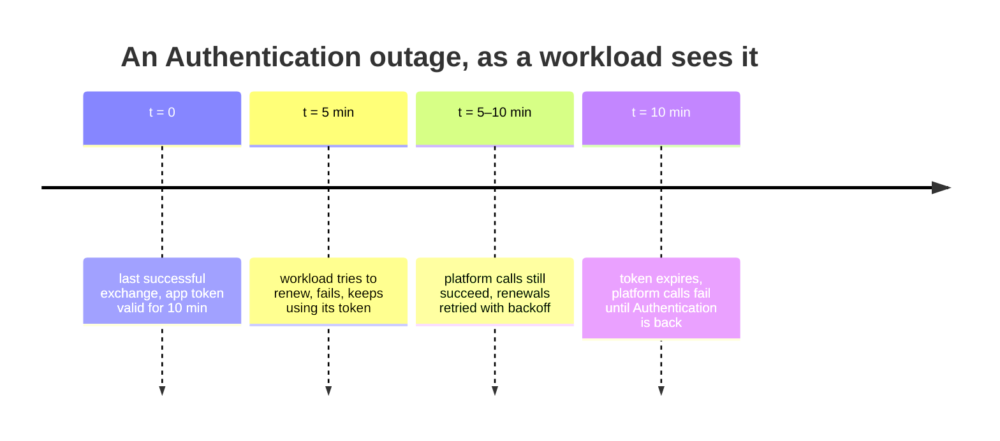

# 7. Operations

**TL;DR**

- An outage shorter than about half the token lifetime is invisible. A longer one stops apps' platform calls.
- Load is about one exchange per workload pod every 5 minutes.
- Everything is behind the `AppTokens` flag and configured under `AppTokenSettings`.
- Pinned cluster keys must be updated before the cluster rotates them. Discovery keys follow automatically.
- A metric with `error.type`, a log line per issued token, and a runbook for the common situations.

> **Drafted with an AI assistant.** Claude Opus 5.5 (`claude-opus-5-5`) in Claude Code wrote this page from the code
> in this repository and the prototype branches, as research to propose a design. Reader: unspecified until a person
> confirms they have read it.

## Availability

Today apps sign their access tokens offline, so Authentication being down doesn't stop apps' platform calls. With
app tokens it can.

**Diagram description:** The timeline follows one workload during an outage of Authentication.
- **At time zero** it gets an app token valid for 10 minutes.
- **At 5 minutes** it tries to renew, fails, and keeps using the token it has.
- **From 5 to 10 minutes** its platform calls still succeed while it retries the renewal with backoff.
- **At 10 minutes** the token expires, and its platform calls fail until Authentication is reachable again.

So an outage shorter than about half the token lifetime is invisible, and a longer one stops apps' platform calls.
Ways to widen the margin, all open:

| Lever | Effect | Cost |
| --- | --- | --- |
| Longer app token lifetime (for example 30 min) | More tolerance | A stolen token lasts longer (T3 in [06](06-security.md#threats)) |
| Renew earlier (at a third of the lifetime) | Two retries before expiry | More exchanges |
| Fall back to the shared-key access token during migration | Full tolerance while both are accepted | Keeps the key in the cluster, so only for the transition ([08](08-rollout.md)) |

The token endpoint, the registry and the app token key share Authentication's existing availability, database and
Key Vault. No new external dependency is added, except each cluster's discovery endpoint when its keys aren't pinned.
That dependency is cached, and a cache refresh failure only hurts after keys rotate.

## Load

One exchange per workload pod per renewal. If the exchange happens in each app, an illustrative 3,000 app pods across
all clusters of an environment, each renewing every 5 minutes, is **about 10 requests per second**. The real pod count
should be measured before rollout. If it happens in the platform proxy, it
is a handful per minute. Each exchange is:
- one indexed primary-key lookup, plus one more for explicit bindings;
- one RSA signature verification;
- one RSA signature.

That's well within what the token endpoint does today. The registry lookup isn't cached in the prototype. A short
in-memory cache (about 30 s) would be a cheap addition, but it delays disabling a cluster by up to that long.

## Configuration

| Setting | Default in the prototype | Meaning |
| --- | --- | --- |
| `FeatureManagement:AppTokens` | `false` | Turns on the grant, the app token metadata and JWKS, and the admin API. Off means none of them exist. |
| `AppTokenSettings:Issuer` | `http://localhost/authentication/api/v1/apptoken` | `iss` of app tokens, per environment, e.g. `https://platform.tt02.altinn.no/authentication/api/v1/apptoken` |
| `AppTokenSettings:Audience` | `http://localhost/` | `aud` of app tokens |
| `AppTokenSettings:AssertionAudience` | `http://localhost/authentication/api/v1/token` | The audience service account tokens must have. It is the token endpoint's public URL, and goes into each cluster's projected volume. |
| `AppTokenSettings:LifetimeMinutes` | `10` | App token lifetime |
| `AppTokenSettings:MaxAssertionLifetimeMinutes` | `60` | The longest service account token accepted. `10` is recommended once clusters are configured for it. |
| `AppTokenSettings:CertificateName` | `AppTokenCertificate` | Key Vault certificate that signs app tokens |
| `AppTokenSettings:CertificatePath`, `CertificatePwd` | empty | A local PKCS #12 file when no Key Vault is configured |
| `AppTokenSettings:RolloverDelayHours` | `48` | How long a new certificate version is published before it signs |

## Certificates and keys

| Key | Owner | Rotation |
| --- | --- | --- |
| **App token signing certificate** | Authentication, in Key Vault | Add a new version. It is published in the JWKS at once and signs after the rollover delay. Consumers must refresh the JWKS on an unknown `kid`. |
| **A cluster's service account signing key** | The cluster | With `discovery_uri`: followed when the cached discovery document refreshes, at the configuration manager's refresh interval. Kubernetes publishes the new key before it signs with it, so normal rotation needs nothing. The prototype doesn't force a refresh on an unknown `kid`; that is a gap to close for unplanned rotations. With a pinned `jwks`: **update the registration first** (old and new keys), then rotate in the cluster, then remove the old key from the registration. |

## Observability

| Signal | Content |
| --- | --- |
| Metric `altinn.authentication.apptoken.exchange` (counter) | One count per exchange. `altinn.service_owner` is set once the issuer is trusted. `error.type` is one of `malformed`, `untrusted_issuer`, `signing_keys_unavailable`, `invalid_token`, `lifetime_too_long`, `subject_not_allowed`, `no_binding`, or absent on success. |
| Log, Information | Each issued token: app (or service owner), subject, cluster |
| Log, Information | Each rejected token from a trusted cluster: cluster and exception type, never the token |
| Log, Warning | A service account without a binding in a cluster that uses bindings |
| Log, Error | A cluster's keys couldn't be read |

Suggested alerts: the rejection rate per `error.type` above a baseline; any `signing_keys_unavailable`; any
registration change (once audited, see [06](06-security.md#required-hardening-before-production)).

## Runbook

| Situation | Action |
| --- | --- |
| A cluster is suspected compromised | `PUT /workloadidentity/issuers/enabled?issuer=<iss>&enabled=false`. New tokens stop at once, and issued tokens expire within `LifetimeMinutes`. |
| The app token key is suspected leaked | Add a new certificate version in Key Vault, then disable the old version **without waiting** for the rollover delay, accepting that consumers reject tokens until their JWKS cache refreshes |
| A cluster's tokens are all rejected with `invalid_token` | Compare the token's `aud` with `AssertionAudience` and its `kid` with the registration's keys. A rotated cluster key with pinned JWKS is the usual cause. |
| `subject_not_allowed` for a new app | The app's namespace isn't in `allowed_namespaces`, or its service account name isn't a DNS label |
| `no_binding` | Add the binding, or switch the cluster to `ServiceAccountName` if names match apps |
