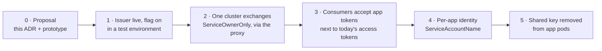

# 8. Rollout

**TL;DR**

- Six phases, from this proposal to removing the shared key from app pods.
- Nothing changes for a consumer until it chooses to accept app tokens.
- Every phase has its own rollback. Only the last one removes anything.
- Phases 2 and 3 go API by API, because one header carries one token.

> **Drafted with an AI assistant.** Claude Opus 5.5 (`claude-opus-5-5`) in Claude Code wrote this page from the code
> in this repository and the prototype branches, as research to propose a design. Reader: unspecified until a person
> confirms they have read it.

The design can be introduced without changing anything for current consumers, and each phase can be undone on its
own. Only the last phase removes anything.

**Diagram description:** There are six phases in sequence.
- **Phase 0:** the proposal, this ADR and the prototype.
- **Phase 1:** the app token issuer is deployed with its feature flag on in a test environment.
- **Phase 2:** one runtime cluster exchanges service account tokens for service-owner-only app tokens, through the
  platform proxy.
- **Phase 3:** the platform APIs accept app tokens next to today's access tokens.
- **Phase 4:** apps get their own service accounts, and clusters switch to per-app identity.
- **Phase 5:** the shared signing key is removed from app pods.

| Phase | In this repository | Elsewhere (interface only) | Done when | Rollback |
| --- | --- | --- | --- | --- |
| **0 · Proposal** | ADR-0005 (Proposed), prototype branches | Discussion: a new issue in this repository that picks up [altinn-authentication#824](https://github.com/Altinn/altinn-authentication/issues/824) | The authentication team accepts, changes or rejects the ADR | n/a |
| **1 · Issuer live** | Production-quality version of the [prototype](11-prototype.md) and the [hardening](06-security.md#required-hardening-before-production). New Key Vault certificate. `AppTokens` on in a test environment (at22). | None | The metadata and JWKS are served, and a test cluster is registered | Flag off |
| **2 · First cluster** | Register the cluster (`ServiceOwnerOnly`, namespaces of the platform proxy) | Platform proxy: a projected service account token with `AssertionAudience`, the exchange, and the app token in `PlatformAccessToken`, *instead of* signing with the `accesstoken` Secret | The proxy gets app tokens, and uses them for calls to consumers that accept them (see the note below) | Proxy back to the shared key. Disable the cluster. |
| **3 · Consumers accept** | None | Each platform API validates app tokens as a second accepted form of `PlatformAccessToken` ([05](05-app-token.md#how-a-consumer-validates-it)), while still accepting today's | Every API that requires `PlatformAccessToken` accepts both | The API stops accepting app tokens |
| **4 · Per-app identity** | Switch clusters to `ServiceAccountName` (or `ExplicitBinding`) | Runtime: a service account per app ([altinn-studio-charts#83](https://github.com/Altinn/altinn-studio-charts/issues/83)). App library (if the exchange is in the app) or a delegation extension (if in the proxy). | App tokens name apps | Switch the cluster back to `ServiceOwnerOnly` |
| **5 · Key removed** | None | Stop mounting the `accesstoken` Secret in app pods. Consumers stop accepting the shared-key tokens from app issuers. | No runtime cluster holds a service owner signing key | Mount it again. The certificates still exist until retired. |

**Note on phase 2.** One header can carry only one token. Until phase 3 is done for an API, a workload calling it
must keep sending today's access token. Phases 2 and 3 can therefore be done per API: a consumer accepts app tokens
first, then the workload switches for calls to that consumer. Alternatively, phase 2 runs against one consumer in a
test environment. Which order is easier depends on how the platform proxy is built, and is decided outside this
repository.

## What has to be true before phase 5

- Every platform API that apps call with a `PlatformAccessToken` accepts app tokens.
- Every place that signs with the shared key on apps' behalf (the app library, the platform proxy, anything else) has
  switched.
- Authentication's availability, monitored with the metrics in [07](07-operations.md#observability), has held for a
  period the operations team is comfortable with, now that apps depend on it online.
