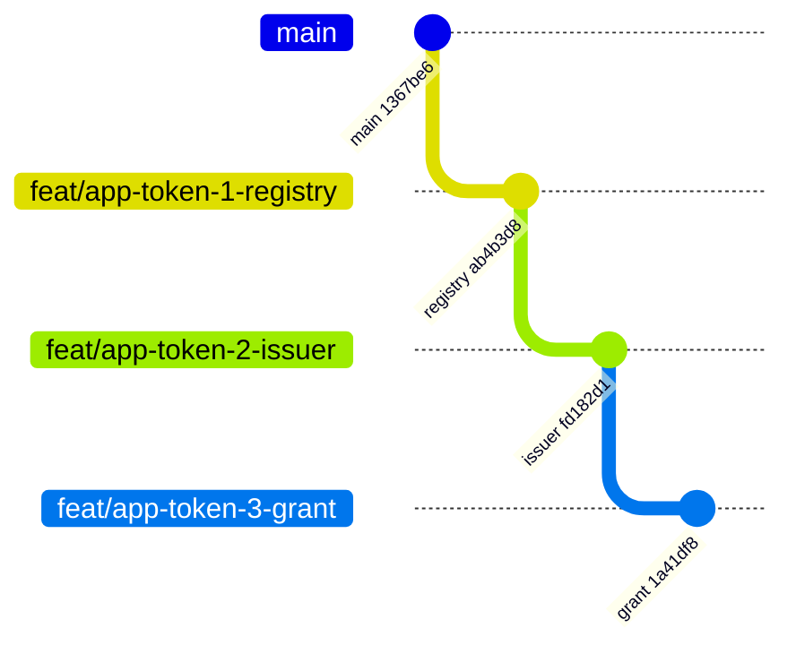

# 11. Prototype

**TL;DR**

- Three stacked branches on a fork illustrate the design: registry, issuer and grant.
- The top branch builds with `-warnaserror`, passes `repoctl check` and the full test suite (721 passed, 2 skipped).
- 49 new tests cover every acceptance and rejection path.
- These are prototypes for discussion. The gaps before production are listed at the end.

> **Drafted with an AI assistant.** Claude Opus 5.5 (`claude-opus-5-5`) in Claude Code wrote this page from the code
> in this repository and the prototype branches, as research to propose a design. Reader: unspecified until a person
> confirms they have read it.

The design is illustrated by three stacked branches on a fork, each building on the one before. They are
**prototypes for discussion**, not pull requests. Verified locally on 2026-11-08 against `main` at `1367be6`:

- Every branch builds the vertical with `-warnaserror`, as CI does.
- On every branch, its own tests pass: 26 on the first, 33 on the second, all new ones on the third. Those counts
  include the two existing `OpenIdController` tests.
- On the top branch, `repoctl check` reports no errors, and the vertical's full suite passes with Testcontainers
  PostgreSQL: 721 passed, 2 skipped (both existing skips), 0 failed.
- CI has not run on them.

| Branch | Adds | Diff |
| --- | --- | --- |
| [`feat/app-token-1-registry`](https://github.com/ivarne-agent/altinn-auth/tree/feat/app-token-1-registry) | The `workload_identity` schema (migration v0.30), the registry model and repository, the admin API, the `AppTokens` flag and admin scope | [against `main`](https://github.com/Altinn/altinn-auth/compare/main...ivarne-agent:altinn-auth:feat/app-token-1-registry) · commit [`ab4b3d8`](https://github.com/ivarne-agent/altinn-auth/commit/ab4b3d845e6749fb8c9843d6eb21d5cd39ed5a17) |
| [`feat/app-token-2-issuer`](https://github.com/ivarne-agent/altinn-auth/tree/feat/app-token-2-issuer) | The app token issuer with its own certificate, issuer, `typ` and claims, the metadata and JWKS endpoints, and the shared certificate selection, Key Vault loading and JWKS building moved out of the Altinn token code | [against branch 1](https://github.com/ivarne-agent/altinn-auth/compare/feat/app-token-1-registry...feat/app-token-2-issuer) · commit [`fd182d1`](https://github.com/ivarne-agent/altinn-auth/commit/fd182d1deea6960032989d70ba64a86bb58c14e0) |
| [`feat/app-token-3-grant`](https://github.com/ivarne-agent/altinn-auth/tree/feat/app-token-3-grant) | The `jwt-bearer` grant on the token endpoint, the service account token validator, app resolution, and the exchange metric | [against branch 2](https://github.com/ivarne-agent/altinn-auth/compare/feat/app-token-2-issuer...feat/app-token-3-grant) · commit [`1a41df8`](https://github.com/ivarne-agent/altinn-auth/commit/1a41df8b93e57a9bb935e29c6506058d4b5b9210) |



**Diagram description:** The branches form a stack on `main` at commit `1367be6`.
- `feat/app-token-1-registry` adds one commit, `ab4b3d8`, with the registry.
- `feat/app-token-2-issuer` starts from it and adds `fd182d1`, the issuer.
- `feat/app-token-3-grant` starts from that and adds `1a41df8`, the grant.

## Where to look

| To see | Open |
| --- | --- |
| The database schema | [Migration/v0.30](https://github.com/ivarne-agent/altinn-auth/tree/1a41df8b93e57a9bb935e29c6506058d4b5b9210/src/apps/Altinn.Authentication/src/Altinn.Platform.Authentication.Persistance/Migration/v0.30) |
| Admin API input validation | [WorkloadIdentityValidation.cs](https://github.com/ivarne-agent/altinn-auth/blob/1a41df8b93e57a9bb935e29c6506058d4b5b9210/src/apps/Altinn.Authentication/src/Altinn.Platform.Authentication/Helpers/WorkloadIdentityValidation.cs) |
| How a service account token is validated | [WorkloadAssertionValidator.cs](https://github.com/ivarne-agent/altinn-auth/blob/1a41df8b93e57a9bb935e29c6506058d4b5b9210/src/apps/Altinn.Authentication/src/Altinn.Platform.Authentication/Services/WorkloadAssertionValidator.cs) |
| How an app is resolved and the token issued | [AppTokenService.cs](https://github.com/ivarne-agent/altinn-auth/blob/1a41df8b93e57a9bb935e29c6506058d4b5b9210/src/apps/Altinn.Authentication/src/Altinn.Platform.Authentication/Services/AppTokenService.cs) |
| What an app token contains | [AppTokenIssuer.cs](https://github.com/ivarne-agent/altinn-auth/blob/1a41df8b93e57a9bb935e29c6506058d4b5b9210/src/apps/Altinn.Authentication/src/Altinn.Platform.Authentication/Services/AppTokenIssuer.cs) |
| How the grant is wired in | [OidcTokenController.cs](https://github.com/ivarne-agent/altinn-auth/blob/1a41df8b93e57a9bb935e29c6506058d4b5b9210/src/apps/Altinn.Authentication/src/Altinn.Platform.Authentication/Controllers/OidcTokenController.cs#L96-L106) |
| A fake cluster that issues service account tokens, for tests | [FakeKubernetesCluster.cs](https://github.com/ivarne-agent/altinn-auth/blob/1a41df8b93e57a9bb935e29c6506058d4b5b9210/src/apps/Altinn.Authentication/test/Altinn.Platform.Authentication.Tests/Fakes/FakeKubernetesCluster.cs) |
| Every acceptance and rejection, as tests | [AppTokenExchangeTests.cs](https://github.com/ivarne-agent/altinn-auth/blob/1a41df8b93e57a9bb935e29c6506058d4b5b9210/src/apps/Altinn.Authentication/test/Altinn.Platform.Authentication.Tests/Controllers/AppTokenExchangeTests.cs) |

## Tests added

| Area | Tests | Kind |
| --- | --- | --- |
| Registry repository | 6 | PostgreSQL (Testcontainers) |
| Registration validation | 14 | Unit |
| Admin API | 4 | Web application and database |
| App token issuer | 4 | Unit |
| App token metadata and JWKS | 3 | Web application |
| Exchange: success paths (three app resolutions, discovery keys) | 4 | Web application and database |
| Exchange: rejections (unknown, disabled, wrong key, three wrong audiences, expired, too long-lived, namespace, client authentication, not a JWT, no binding, keys unavailable, flag off) | 14 | Web application and database |

Run them with:

```bash
dotnet test src/apps/Altinn.Authentication/test/Altinn.Platform.Authentication.Tests \
  --filter "FullyQualifiedName~WorkloadIdentity|FullyQualifiedName~TrustedWorkloadIssuer|FullyQualifiedName~AppToken"
```

## What the prototype leaves out

| Gap | Why it matters | Where it is discussed |
| --- | --- | --- |
| Audit trail for registry writes | The registry is security-critical | [06](06-security.md#required-hardening-before-production) |
| Rate limiting of the grant | One cluster can starve others | [Q9](10-open-questions.md#q9-rate-limiting) |
| Refresh of a cluster's discovery keys on an unknown `kid` | Unplanned cluster key rotations | [07](07-operations.md#certificates-and-keys) |
| Caching of registry lookups | Load, at a cost in how fast disabling takes effect | [07](07-operations.md#load) |
| Updates to `docs/flows/` and `docs/architecture.md` | The repository's rules require them with a behaviour change | Done with the production version |
| A delete endpoint for registrations | Deliberately left out, so history is kept | [03](03-trust-registry.md#lifecycle) |
| Key Vault loading still uses the obsolete `X509Certificate2` constructor | Pre-existing (SYSLIB0057), moved as is | A separate clean-up |
| Migration folder `v0.30` | Must be renumbered if another migration lands first | n/a |

## Rough size of the production version

| Work | Size |
| --- | --- |
| Registry, admin API and audit | M |
| App token issuer, certificate provisioning, metadata and JWKS | S–M |
| Grant and validation, including hardening | M |
| Docs (flows, architecture, operations) | S |
| Threat-model review and test-environment rollout | S–M |

Sizes are relative (S, M, L) and cover this repository only.
